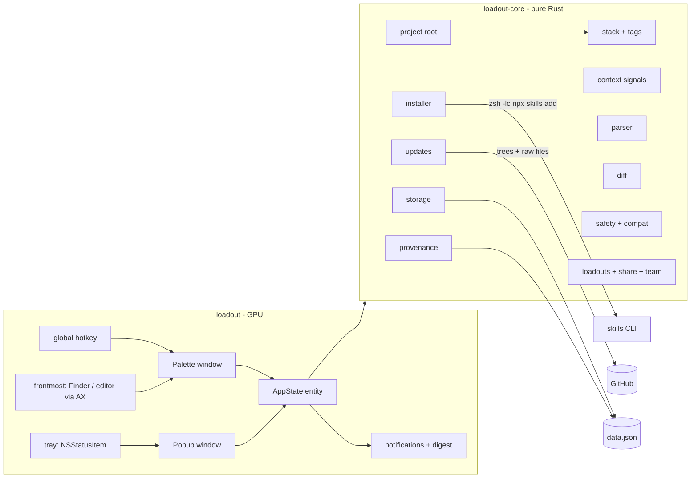

# Loadout — Architecture (Rust + GPUI)

## Overview

A single-process macOS menu bar app in Rust. UI with **GPUI** (Zed's GPU-accelerated framework, Metal on macOS) and
**GPUI Kit** (Longbridge's components). No server.

Two surfaces:
- **Palette** (⌃⌥L, 520 pt): the main flow — detect the project you're in, suggest and rank skills for its stack + context, install, optionally launch agent, diff against loadout.
- **Popup** (menu bar click, 340 pt): glance at updates, manage favorites, view provenance, trigger digest.

Outside dependencies at runtime:
1. The official **`skills` CLI** (`npx skills add`) performs every install and update.
2. The **GitHub REST API** (read-only, unauthenticated by default) provides skill versions and file contents.
3. Optional agent launchers (Pi, Cursor, etc.) via `open` / URL schemes / CLI when "equip + launch" is used.



## Crates

- **`loadout-core`** — every rule and non-UI side effect: parsing, project/stack/context detection, commands, GitHub, diff, safety/compat, storage, share links, provenance, loadout versioning. No GPUI dependency; `cargo test -p loadout-core` covers most behavior.
- **`loadout`** — the GPUI binary: palette, popup, tray, hotkey, frontmost-app detection, notifications, login item, agent launch.

## Repository layout

```
loadout/
  Cargo.toml                      workspace
  rust-toolchain.toml
  crates/
    loadout-core/src/
      lib.rs
      model.rs                    Favorite, Project, Loadout, Settings, SavedState (+ favorite edits), ProvenanceEntry
      storage.rs                  load/save data.json (atomic), prototype import
      agents.rs                   agent ids, project/global skill folders, launch commands
      parser.rs                   paste text → Vec<Favorite>
      ui_skills.rs                resolve ui-skills.com links
      project.rs                  find project root from any path                         (U1)
      stack.rs                    detect stack tags with evidence                         (U2)
      context.rs                  recent files / open editors / git signals for ranking   (U2)
      tags.rs                     suggest tags for a favorite; match + rank to stack+context (U2)
      installer.rs                build + run `npx skills add/remove`, streaming
      installed.rs                read skills-lock.json / agent folders for existing installs
      updates.rs                  GitHub trees, version per favorite                      (U3)
      diff.rs                     SKILL.md diff + file changes (`similar`)                (U3)
      safety.rs                   heuristic scan + compatibility notes                    (U4)
      loadout_diff.rs             missing / extra skills vs a loadout                     (U7)
      share.rs                    loadout:// links, .loadout.json, team versioning        (U5, U10)
      provenance.rs               append-only local audit log                             (U8)
      digest.rs                   when the digest is due, and its one-line summary        (U11)
      launch.rs                   preferred-agent launch helpers                          (U9)
    loadout-core/tests/fixtures/  projects/, trees/, html/, data/
    loadout/src/
      main.rs                     Application, gpui_kit::init, activation policy, hotkey, tray, timers
      assets.rs                   GPUI Kit assets + extra icons (icon_assets!)
      state.rs                    AppState entity: data + session + actions
      hotkey.rs                   ⌃⌥L via global-hotkey, polled by a GPUI timer
      tray.rs                     NSStatusItem (objc2), popup toggle, icon state
      windows.rs                  palette + popup lifecycle, positioning, close on blur
      views/
        palette.rs                search, Into line, sections, keyboard, equip+launch
        popup.rs                  header, paste field, list, footer, digest status
        favorite_row.rs
        preview.rs                preview + what changed + safety/compat findings
        loadout_diff.rs           missing/extra skills view
        provenance.rs             simple log view
        settings.rs
      macos/
        frontmost.rs              frontmost app → folder (Finder AppleScript, AXDocument for editors)
        login_item.rs             SMAppService
        url_scheme.rs             loadout:// and opened-file events, drained by the main poll loop
        launch.rs                 open agent via URL scheme / CLI
    loadout/assets/           tray/menubar@2x.png (template), icons/ only if GPUI Kit's set lacks one
  packaging/
    Info.plist                    LSUIElement, CFBundleURLTypes (loadout), NSAppleEventsUsageDescription
    bundle.sh                     release build → Loadout.app (+ --install, --universal, --release)
    AppIcon.icns, icon/           app icon + make-icns.sh / make-menubar.sh (regenerate from reference art)
  reference/swift-prototype/      earlier SwiftUI version (old name SkillDock); behavior reference
  docs/
  AGENTS.md                       rules for Pi Harness (and other agents)
```

## Dependencies

Pin exact versions in `Cargo.toml` at T0.1 after checking crates.io. Let **`gpui-kit` choose the GPUI version**;
don't add a separate `gpui` line unless GPUI Kit's docs say so.

| Crate | Where | Use |
|---|---|---|
| `gpui-kit` | app | Components, theme, `Root`; brings the matching GPUI |
| `objc2`, `objc2-foundation`, `objc2-app-kit` | app | Tray, activation policy, `NSWorkspace` frontmost app, `NSAppleScript` |
| Accessibility FFI (`accessibility-sys` or a small `extern "C"` block + `core-foundation`) | app | `AXDocument` of the focused window — decide in T0.3 |
| `objc2-service-management` | app | Open at login (notifications come from GPUI itself, DECISIONS 019) |
| `global-hotkey` | app | ⌃⌥L |
| `security-framework` | app | GitHub token in Keychain (M5) |
| `serde`, `serde_json`, `uuid` | core | Data, GitHub responses |
| `ureq` (rustls) | core | Blocking HTTP, always off the main thread |
| `sha2`, `hex` | core | Whole-repo version hash |
| `similar` | core | Line diff |
| `regex` | core | Parser, ui-skills scraping, safety rules |
| `base64` | core | Share links |
| `dirs` | core | Application Support path |
| `thiserror` (core), `anyhow` (app) | both | Errors |
| `chrono` or `time` | core | Provenance timestamps, digest windows |

No tokio. Blocking work runs on GPUI's background executor.

## Data model (`loadout-core::model`)

```rust
#[serde(rename_all = "camelCase")]
pub struct Favorite {
    pub id: Uuid,
    pub name: String,
    pub source: String,              // anything `npx skills add` accepts
    pub skill: Option<String>,       // None = every skill in the source
    #[serde(default)] pub tags: Vec<String>,          // stack tags, e.g. ["react","nextjs"]
}

pub struct Project {
    pub id: Uuid,
    pub path: PathBuf,
    #[serde(default)] pub last_used: Option<u64>,
}

pub struct Loadout {
    pub id: Uuid,
    pub name: String,
    pub favorite_ids: Vec<Uuid>,
    #[serde(default)] pub tags: Vec<String>,          // suggest this loadout for matching stacks
    #[serde(default)] pub preferred_agent: Option<String>, // "pi", "claude-code", "cursor", …
    #[serde(default)] pub version: Option<String>,    // for team/shared loadouts
    #[serde(default)] pub source: Option<String>,     // https URL the team publishes it at
}

pub struct Settings {
    #[serde(default = "default_agents")] pub agents: String,     // comma-separated or primary
    #[serde(default = "default_hotkey")] pub hotkey: String,     // "ctrl+alt+KeyL"
    #[serde(default)] pub global: bool,                          // prototype key
    #[serde(default)] pub auto_check: bool,                      // prototype key "autoCheck"
    #[serde(default)] pub digest_enabled: bool,                  // U11
    #[serde(default)] pub digest_interval_hours: u32,            // e.g. 24 or 168
    #[serde(default)] pub launch_after_install: bool,            // default for equip+launch
    #[serde(default)] pub launchers: BTreeMap<String, String>,   // agent id → shell command, {dir} = project
    // … other calm defaults
}

pub struct ProvenanceEntry {
    pub id: Uuid,
    pub ts: u64,                     // unix seconds
    pub action: String,              // "install" | "update" | "remove" | "apply_loadout"
    pub project_path: Option<String>,
    pub skill_source: String,
    pub skill_name: Option<String>,
    pub tree_sha: Option<String>,
    pub loadout_id: Option<Uuid>,
    pub agent: Option<String>,
    pub note: Option<String>,
}

pub struct SavedState {
    pub favorites: Vec<Favorite>,
    pub projects: Vec<Project>,
    pub loadouts: Vec<Loadout>,
    pub settings: Settings,
    pub selected_project_id: Option<Uuid>,       // prototype key "selectedProjectID"
    pub installed: BTreeMap<String, String>,     // prototype key: "<project id|global>|<favorite id>" → version
    pub skill_state: BTreeMap<String, SkillState>, // key = source or source@skill: pinned, ignoredVersion, notifiedVersion
    #[serde(default)] pub provenance: Vec<ProvenanceEntry>,
    #[serde(default)] pub last_digest: Option<u64>,     // "lastDigest": when the digest last ran
    // keep append-only; trim old entries in a later polish task if needed
}
```

## Key flows

### Equip (palette Return)
1. Resolve target project (U1) + stack + light context signals (U2).
2. Rank/pre-select favorites and matching loadouts.
3. On Return: run `npx skills add` for selected items that are not already installed.
4. Write provenance entries (U8).
5. If equip+launch (U9) and a preferred agent is known → launch.

### Diff against loadout (U7)
Compare installed skills in the target project vs the loadout’s favorite set.
Show missing / extra / up-to-date in a simple list. No automatic install; user confirms.

### Update (U3)
GitHub tree SHA of the skill folder only. README-only changes never surface.
Before applying: show file list + SKILL.md diff. Pin or ignore supported.

### Safety + compatibility (U4)
Heuristic scan on first install of a skill into any project. Flags common risky patterns and notes simple compatibility signals. Never blocks; only informs.

### Team loadouts (U10)
A versioned `.loadout.json` (or `loadout://` payload) that includes a version field and optional signature/source.
Import still goes through the same apply path and official CLI.

### Digest (U11)
Background timer (or login-item friendly check). If real updates exist across projects since last digest, post one quiet notification summarizing count + top skills. User can open the popup from it.

## Rules (enforced in AGENTS.md)

- Logic lives in `loadout-core` and is unit-tested.
- `loadout` stays thin: views call `AppState` methods; no process/HTTP/file I/O in views.
- Never run `npx skills check` or `npx skills update`.
- Every shell argument goes through `shq`.
- No new dependencies without a DECISIONS entry.
- Persist with `#[serde(default)]`; never rename or remove keys casually.
- Provenance is append-only and local-only.
