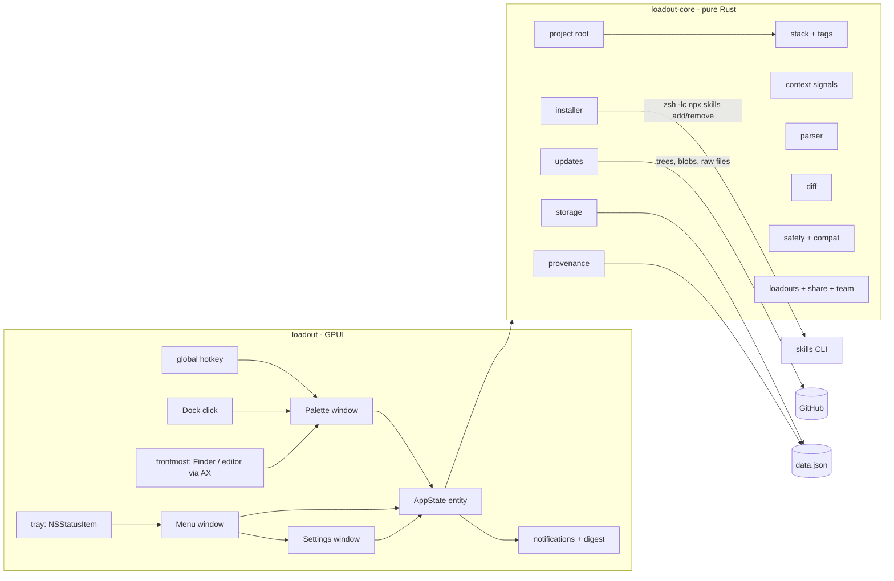

# Loadout — Architecture (Rust + GPUI)

## Overview

A single-process macOS app in Rust that lives in the menu bar (and optionally the Dock). UI with **GPUI** (Zed's
GPU-accelerated framework, Metal on macOS) and **GPUI Kit** (Longbridge's components). No server.

Three surfaces:
- **Palette** (⌃⌥L or a Dock click, 750 × 475 pt): the main flow. Detect the project you're in, suggest and rank
  skills and loadouts for its stack and context, install (with a safety glance), optionally launch the agent, diff
  against a loadout, preview a skill, pick another project.
- **Menu** (menu bar click, 290 pt): status, target, version, Open Palette, Update All, Check for Updates…,
  Settings…, Quit.
- **Settings** (a normal window with a sidebar): General, Shortcuts, Integrations, Notifications, Skills,
  Loadouts, Projects, History, About. Managing favorites, loadouts, projects, and history happens here.

Outside dependencies at runtime:
1. The official **`skills` CLI** (`npx -y skills add/remove … -y`) performs every install, update, and uninstall.
2. The **GitHub REST API** (read-only; a token from the Keychain is optional) provides skill versions and folder
   listings; `raw.githubusercontent.com` provides file text for the safety scan.
3. Agent launchers: a `.command` file run by Terminal for CLI agents, `open -a` for editors, or the user's own
   command (`settings.launchers`).



## Crates

- **`loadout-core`** — every rule and non-UI side effect: parsing, project/stack/context detection, commands,
  GitHub, diff, safety/compat, storage, share links, provenance, loadout versioning, digest timing, shortcut
  formats. No GPUI dependency; `cargo test -p loadout-core` covers most behavior (149 tests).
- **`loadout`** — the GPUI binary: palette, menu, Settings window, tray, Dock icon, hotkey, frontmost-app
  detection, notifications, login item, Keychain, agent launch.

## Repository layout

```
loadout/
  Cargo.toml                      workspace
  rust-toolchain.toml
  crates/
    loadout-core/src/
      lib.rs
      model.rs                    Favorite, Project, Loadout, Settings, SkillState, SavedState (+ edits), ProvenanceEntry
      storage.rs                  load/save data.json (atomic), prototype import, corrupt-file recovery
      agents.rs                   agent ids, names, project/global skill folders, list parsing
      parser.rs                   paste text → Vec<Favorite>
      ui_skills.rs                resolve ui-skills.com links
      project.rs                  find project root from any path
      stack.rs                    detect stack tags with evidence
      context.rs                  open file / git changes / recent files for ranking
      contrast.rs                 WCAG contrast ratio, used to keep palette colors readable
      tags.rs                     suggest tags for a favorite; rank to stack + context
      installer.rs                build + run `npx skills add/remove`, streaming
      installed.rs                read skills-lock.json / agent folders for existing installs
      updates.rs                  GitHub trees, version per favorite, raw file reads
      diff.rs                     SKILL.md diff + file changes (`similar`)
      safety.rs                   heuristic scan + compatibility notes
      loadout_diff.rs             missing / present / extra skills vs a loadout
      share.rs                    loadout:// links, .loadout.json, team versions
      provenance.rs               append-only local audit log, one-line descriptions
      launch.rs                   which launcher opens an agent
      digest.rs                   when the digest is due, and its one-line summary
      shortcut.rs                 palette shortcut: spec ↔ ⌃⌥L display ↔ recorded keystroke
    loadout-core/tests/fixtures/  projects/, trees/, html/, data/
    loadout/src/
      main.rs                     Application, init, key bindings, app menu, hotkey + tray poll, hourly tick
      assets.rs                   GPUI Kit assets, extra icons (icon_assets!), app icon variants
      state.rs                    AppState entity: data + session + every action (install, update, check, …)
      hotkey.rs                   palette shortcut via global-hotkey (live re-register)
      tray.rs                     NSStatusItem (objc2): click flag, update dot, visibility
      windows.rs                  palette, menu, and Settings window lifecycle and positioning
      views/
        palette.rs                search, target chip, sections, keyboard, ⌘K actions; in its list area:
                                  skill preview (⌘Y), diff against loadout (⌘D), project chooser (⌘P)
        menu.rs                   the menu bar menu
        settings.rs               Settings window: sidebar, routing, General / Shortcuts / Integrations /
                                  Notifications / Projects / History pages
        settings/library.rs       Skills (favorites, what changed) and Loadouts (members, import preview)
        settings/about.rs         About: app icon, name, version
      macos/
        frontmost.rs              frontmost app → folder (Finder via osascript, AXDocument for the rest)
        login_item.rs             SMAppService
        dock.rs                   Dock icon image (app icon variants)
        keychain.rs               GitHub token in the login Keychain
        url_scheme.rs             loadout:// and opened-file events, drained by the main poll loop
        launch.rs                 open an agent: .command file, open -a, or a custom command
    loadout/assets/               tray/ (template icons), app-icon/ (variants from make-variants.sh)
  packaging/
    Info.plist                    LSUIElement, URL scheme, JSON Open With, Apple events description
    bundle.sh                     release build → Loadout.app (--install, --universal, --release)
    entitlements.plist            hardened runtime (Apple events) for Developer ID builds
    homebrew/loadout.rb           cask template; version + sha256 come from bundle.sh --release
    AppIcon.icns, icon/           app icon + make-icns.sh / make-menubar.sh / make-variants.sh
  reference/                      SwiftUI prototype (SkillDock) and design reference images
  docs/                           PRODUCT, ARCHITECTURE, DESIGN, DECISIONS, PLAN, RELEASE, COMPETITORS
  AGENTS.md                       rules for coding agents working in this repo
```

## Dependencies

GPUI comes from `gpui-kit` (pinned `=0.8.1`, which brings `gpui-pre` 0.3.10); don't add a separate `gpui` line.
Adding a crate needs a `DECISIONS.md` entry and the owner's OK.

| Crate | Where | Use |
|---|---|---|
| `gpui-kit` | app | GPUI, components, theme, assets |
| `objc2`, `objc2-foundation`, `objc2-app-kit` | app | Tray, Dock icon, activation, `NSWorkspace` frontmost app, screens |
| `core-foundation` | app | Accessibility FFI (`AXDocument`) through a small `extern "C"` block |
| `objc2-service-management` | app | Open at login |
| `global-hotkey` | app | The palette shortcut |
| `security-framework` | app | GitHub token in the Keychain |
| `anyhow` | app | Errors |
| `serde`, `serde_json`, `uuid` | core | Data, GitHub responses, share files |
| `ureq` (rustls) | core | Blocking HTTP, always off the main thread |
| `sha2`, `hex` | core | Whole-repo and root-skill version hashes |
| `similar` | core | Line diff |
| `regex` | core | ui-skills scraping, stack and safety rules |
| `base64` | core | GitHub blobs, share links |
| `dirs` | core | Application Support and cache paths |
| `thiserror` | core | Errors |

No tokio. Blocking work runs on GPUI's background executor; notifications are posted through GPUI.

## Data model (`loadout-core::model`)

Persisted as `~/Library/Application Support/Loadout/data.json`. Keys are camelCase; every field has a default;
prototype keys (`autoCheck`, `global`, `selectedProjectID`, `installed`) are kept (DECISIONS 020).

```rust
pub struct Favorite {
    pub id: Uuid,
    pub name: String,
    pub source: String,              // anything `npx skills add` accepts
    pub skill: Option<String>,       // None = every skill in the source
    pub tags: Vec<String>,           // e.g. ["react", "nextjs"]; suggested when empty
}

pub struct Project {
    pub id: Uuid,
    pub path: PathBuf,
    pub last_used: Option<u64>,      // unix seconds
}

pub struct Loadout {
    pub id: Uuid,
    pub name: String,                // unique, case-insensitive
    pub favorite_ids: Vec<Uuid>,
    pub tags: Vec<String>,           // suggest for matching stacks; else the union of its skills' tags
    pub preferred_agent: Option<String>, // "pi", "claude-code", "cursor", …
    pub version: Option<String>,     // team loadouts
    pub source: Option<String>,      // https URL the team publishes it at
}

pub struct Settings {
    pub agents: String,              // "-a" list, "claude-code, cursor"; empty = the CLI detects
    pub global: bool,                // install with -g instead of into a project
    pub auto_check: bool,            // 6-hourly update checks (default on)
    pub hotkey: String,              // "ctrl+alt+KeyL"
    pub digest_enabled: bool,
    pub digest_interval_hours: u32,  // 24 or 168
    pub launch_after_install: bool,  // Return also opens the agent
    pub launchers: BTreeMap<String, String>, // agent id → shell command, {dir} = project
    pub app_icon: AppIcon,           // default | twilight | graphite
    pub icon_place: IconPlace,       // menuBar | dockAndMenuBar | dock
    pub show_window_on_launch: bool,
}

pub struct SkillState {              // keyed by "source" or "source@skill"
    pub pinned: bool,
    pub ignored_version: Option<String>,
    pub notified_version: Option<String>,
}

pub struct ProvenanceEntry {
    pub id: Uuid,
    pub ts: u64,                     // unix seconds
    pub action: String,              // install | update | remove | apply_loadout | import_loadout
    pub project_path: Option<String>,
    pub skill_source: String,
    pub skill_name: Option<String>,
    pub tree_sha: Option<String>,
    pub loadout_id: Option<Uuid>,
    pub agent: Option<String>,
    pub note: Option<String>,        // "from Web app", "version 1.2"
}

pub struct SavedState {
    pub favorites: Vec<Favorite>,
    pub projects: Vec<Project>,
    pub loadouts: Vec<Loadout>,
    pub settings: Settings,
    pub selected_project_id: Option<Uuid>,         // "selectedProjectID"
    pub installed: BTreeMap<String, String>,       // "<project id|global>|<favorite id>" → version ("?" = unknown)
    pub provenance: Vec<ProvenanceEntry>,          // append-only
    pub skill_state: BTreeMap<String, SkillState>,
    pub last_digest: Option<u64>,
}
```

The GitHub token is not in data.json; it's in the login Keychain (service `local.loadout.app`).

## Key flows

### Equip (palette Return)
1. Detect the target off the main thread: frontmost app → folder → project root → stack, installed skills, and
   context signals. A chosen project or Global overrides it.
2. Rank favorites and loadouts; pre-select stack matches.
3. On Return: expand loadouts into skills; skip installed ones; update the ones behind.
4. First installs get the safety glance (scan, then a notice; Return again installs anyway).
5. Run `npx skills add` one by one, streaming output; record versions, `install`/`update` provenance, and one
   `apply_loadout` entry per loadout.
6. With ⌘↩ (or "open after installing"), open the agent unless every job failed.

### Diff against loadout
Missing (selectable, pre-selected), installed, and extra skills for the target, computed live from Loadout's
records plus the lock file and agent folders. Return installs the missing ones through the equip flow.

### Update
An hourly tick runs the 6-hourly check (or the digest when it's on): one tree listing per repo, only for skills
with a known installed version. A version is the skill folder's tree SHA, so README-only changes never surface.
What changed shows the file list and SKILL.md diff. Pin and ignore persist in `skillState`.

### Team loadouts
A `.loadout.json` or `loadout://` link with `version` and an https `source`. "Check for a newer version" fetches the
source and previews the import only if it's newer. Every import is validated and previewed; nothing installs until
the palette.

### Digest
When on and due, one check and at most one notification per interval naming what's pending. Clicking it opens
Settings → Skills.

## Rules (enforced in AGENTS.md)

- Logic lives in `loadout-core` and is unit-tested.
- `loadout` stays thin: views call `AppState` methods; no process/HTTP/file I/O in views.
- Never run `npx skills check` or `npx skills update`.
- Every shell argument goes through `shq`.
- No new dependencies without a DECISIONS entry.
- Persist with `#[serde(default)]`; never rename or remove keys.
- Provenance is append-only and local-only.
